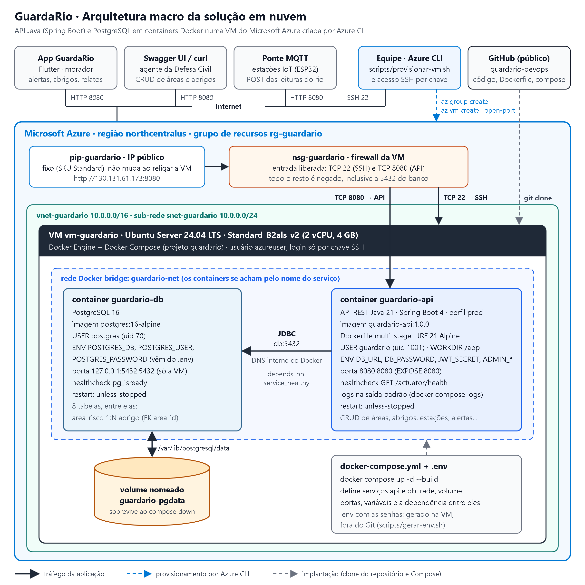
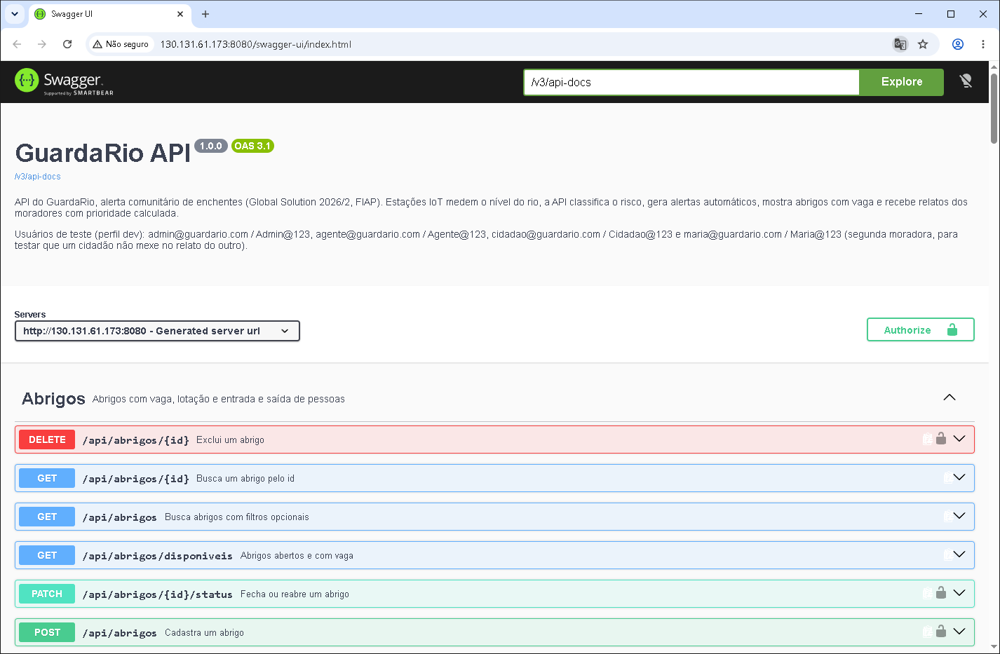
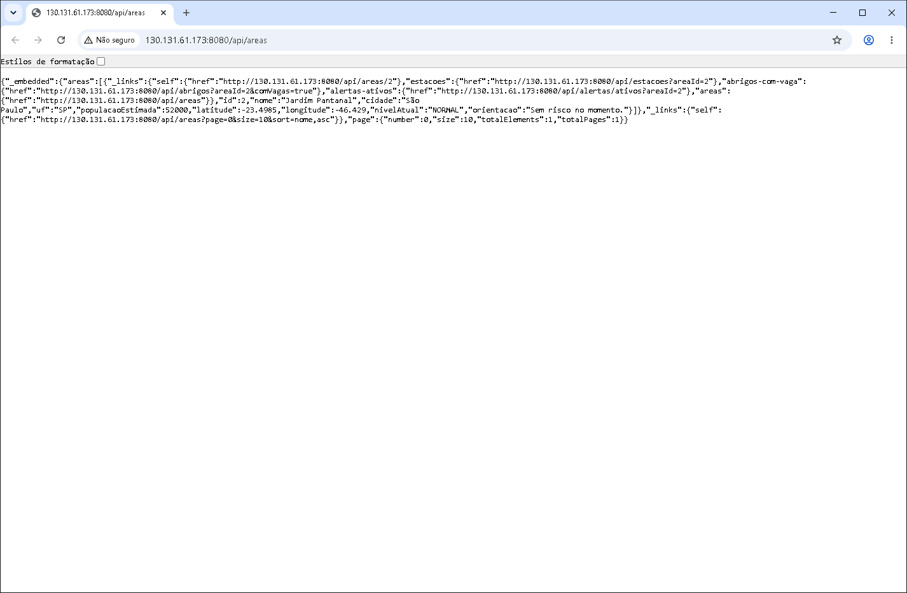
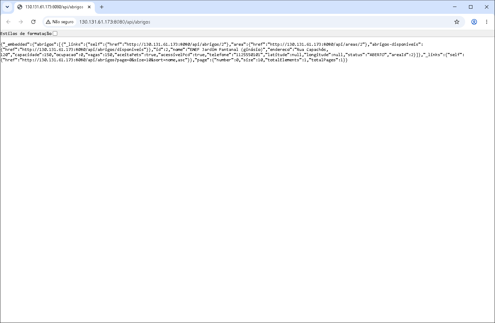

# GuardaRio · DevOps Tools & Cloud Computing

**Global Solution 2026/2 · FIAP · CitizenTech**

O GuardaRio é um alerta comunitário de enchentes: estações medem o nível do rio, a API gera os alertas da área e o app mostra ao morador os abrigos com vaga. É a solução do grupo para o tema CitizenTech: o cidadão beneficiado é o morador de área de risco de enchente, e o projeto se liga aos ODS 11 (cidades sustentáveis) e 13 (ação climática). Este repositório coloca a **API Java (Spring Boot) e o PostgreSQL em containers Docker, numa VM do Microsoft Azure criada por Azure CLI**.

| | |
|---|---|
| Aplicação na VM Azure | http://130.131.61.173:8080/swagger-ui.html (a VM fica desligada fora das demonstrações; para religar, veja [Desligar e religar a VM](#desligar-e-religar-a-vm)) |
| Vídeo da demonstração | **A PREENCHER** (link do YouTube, não listado) |
| Código da API | pasta [`api/`](api/), a mesma API da entrega de Java Advanced ([guardario-api](https://github.com/Raphael-Sinelli/guardario-api)) |

## Integrantes

| Nome | RM |
|---|---|
| Henrique Spoltore Moreno Pavão dos Santos | RM568130 |
| Raphael Oliveira Sinelli Mendonça | RM568346 |
| Arthur Lins Belarmino | RM566845 |

## Sumário

- [Arquitetura macro](#arquitetura-macro)
- [O que tem neste repositório](#o-que-tem-neste-repositório)
- [Onde está cada requisito](#onde-está-cada-requisito)
- [How To: do zero até o CRUD na nuvem](#how-to-do-zero-até-o-crud-na-nuvem)
  - [1. Provisionar a VM com Azure CLI](#1-provisionar-a-vm-com-azure-cli)
  - [2. Instalar o Docker dentro da VM](#2-instalar-o-docker-dentro-da-vm)
  - [3. Subir os containers com Docker Compose](#3-subir-os-containers-com-docker-compose)
  - [4. CRUD pelo IP público](#4-crud-pelo-ip-público)
  - [5. SELECT direto no banco](#5-select-direto-no-banco)
  - [6. Persistência dos dados](#6-persistência-dos-dados)
- [Evidências](#evidências)
- [Dockerfile explicado](#dockerfile-explicado)
- [Docker Compose explicado](#docker-compose-explicado)
- [Variáveis de ambiente](#variáveis-de-ambiente)
- [Operação do dia a dia](#operação-do-dia-a-dia)
- [Segurança](#segurança)
- [Problemas comuns](#problemas-comuns)
- [Uso de IA generativa](#uso-de-ia-generativa)

## Arquitetura macro



O morador (app), o agente da Defesa Civil (Swagger) e a ponte das estações IoT chegam pela internet ao IP público da VM, na porta 8080. O NSG da Azure só deixa entrar a 22 (SSH) e a 8080 (API). Dentro da VM, o Docker Compose mantém dois containers na rede `guardario-net`: a API fala com o banco pelo nome `db`, e o banco grava no volume nomeado `guardario-pgdata`.

| Recurso | Nome | Detalhe |
|---|---|---|
| Grupo de recursos | `rg-guardario` | região `northcentralus` |
| Rede virtual e sub-rede | `vnet-guardario` / `snet-guardario` | `10.0.0.0/16` e `10.0.0.0/24` |
| Firewall (NSG) | `nsg-guardario` | entrada: TCP 22 e TCP 8080 |
| IP público | `pip-guardario` | SKU Standard, fixo |
| Máquina virtual | `vm-guardario` | Ubuntu Server 24.04 LTS, `Standard_B2als_v2` (2 vCPU, 4 GB) |
| Rede Docker | `guardario-net` | bridge |
| Container da aplicação | `guardario-api` | imagem `guardario-api:1.0.0`, porta `8080:8080`, usuário `guardario` |
| Container do banco | `guardario-db` | imagem `postgres:16-alpine`, porta `127.0.0.1:5432:5432`, usuário `postgres` |
| Volume nomeado | `guardario-pgdata` | montado em `/var/lib/postgresql/data` |

O arquivo editável do diagrama é o [`docs/arquitetura.svg`](docs/arquitetura.svg).

## O que tem neste repositório

```
guardario-devops/
├── Dockerfile               imagem da API em dois estágios (build com JDK, execução com JRE)
├── docker-compose.yml       serviços api e db, rede, volume, portas, variáveis e dependência
├── .dockerignore            só o código da API entra no build
├── .env.example             modelo das variáveis de ambiente (o .env não vai para o Git)
├── api/                     código-fonte da API Java 21 + Spring Boot 4 (com o README dela)
├── scripts/
│   ├── provisionar-vm.sh    Azure CLI: grupo de recursos, rede, NSG, IP público e VM
│   ├── instalar-docker.sh   Docker Engine e Docker Compose dentro da VM
│   ├── gerar-env.sh         cria o .env com senhas e chave JWT aleatórias
│   ├── testar-crud.sh       CRUD completo em duas tabelas relacionadas, pelo IP público
│   ├── evidencias.sh        containers, logs, exec, SELECT, volume, rede e persistência
│   └── remover-recursos.sh  apaga o grupo de recursos depois da apresentação
└── docs/
    ├── arquitetura.png      arquitetura macro (e o .svg editável)
    └── evidencias/          prints e saídas reais da VM
```

## Onde está cada requisito

| Requisito da entrega | Como foi atendido | Onde conferir |
|---|---|---|
| VM no Azure por Azure CLI, com os comandos documentados | `az group create`, `az vm create`, `az vm open-port` | [`scripts/provisionar-vm.sh`](scripts/provisionar-vm.sh), [passo 1](#1-provisionar-a-vm-com-azure-cli) |
| Docker e Docker Compose instalados na VM | repositório oficial do Docker no apt | [`scripts/instalar-docker.sh`](scripts/instalar-docker.sh), [passo 2](#2-instalar-o-docker-dentro-da-vm) |
| Aplicação Java em container | Spring Boot 4, imagem própria em dois estágios | [`Dockerfile`](Dockerfile) |
| Usuário não privilegiado | `USER guardario` (uid 1001) na API e `user: postgres` (uid 70) no banco | [`Dockerfile`](Dockerfile), [`docker-compose.yml`](docker-compose.yml) |
| `WORKDIR` | `/workspace` no build e `/app` na execução | [`Dockerfile`](Dockerfile) |
| Variável de ambiente | `ENV` no Dockerfile e `environment` no Compose, com os valores no `.env` | [Variáveis de ambiente](#variáveis-de-ambiente) |
| Porta exposta | `EXPOSE 8080` e `ports: "8080:8080"` | [`Dockerfile`](Dockerfile), [`docker-compose.yml`](docker-compose.yml) |
| Banco em container, com porta e variáveis | PostgreSQL 16, `POSTGRES_DB`, `POSTGRES_USER`, `POSTGRES_PASSWORD`, porta 5432 | [`docker-compose.yml`](docker-compose.yml) |
| Volume nomeado e persistência | `guardario-pgdata` em `/var/lib/postgresql/data` | [passo 6](#6-persistência-dos-dados) |
| Duas tabelas relacionadas | `area_risco` 1:N `abrigo`, com a chave estrangeira `abrigo.area_id` | [passo 5](#5-select-direto-no-banco) |
| CRUD completo | POST, GET, PUT e DELETE de área e de abrigo | [passo 4](#4-crud-pelo-ip-público) |
| Compose com aplicação, banco, rede, volume, portas, variáveis e dependência | `depends_on` com `condition: service_healthy` | [`docker-compose.yml`](docker-compose.yml) |
| Containers em background | `docker compose up -d` | [passo 3](#3-subir-os-containers-com-docker-compose) |
| Logs, acesso aos containers, usuário e diretórios | `docker compose logs` e `docker exec` nos dois containers | [Evidências](#evidências) |
| Arquitetura macro | diagrama com os nomes reais dos recursos | [Arquitetura macro](#arquitetura-macro) |

## How To: do zero até o CRUD na nuvem

Você precisa de uma conta Azure (a Azure for Students serve) e da Azure CLI. Quem não quiser instalar nada pode usar o [Azure Cloud Shell](https://shell.azure.com) em modo Bash, que já vem com a CLI, o `git` e o `ssh`.

### 1. Provisionar a VM com Azure CLI

No seu computador ou no Cloud Shell:

```bash
git clone https://github.com/Raphael-Sinelli/guardario-devops.git
cd guardario-devops
./scripts/provisionar-vm.sh
```

O script roda os comandos abaixo, nesta ordem. Dá para colar um por um, se preferir:

```bash
az login

# 1. grupo de recursos
az group create --name rg-guardario --location northcentralus \
  --tags projeto=guardario disciplina=devops

# 2. VM Ubuntu 24.04 com rede, sub-rede, NSG (porta 22 liberada) e IP público fixo
az vm create \
  --resource-group rg-guardario \
  --name vm-guardario \
  --image Ubuntu2404 \
  --size Standard_B2als_v2 \
  --admin-username azureuser \
  --generate-ssh-keys \
  --vnet-name vnet-guardario --vnet-address-prefix 10.0.0.0/16 \
  --subnet snet-guardario --subnet-address-prefix 10.0.0.0/24 \
  --nsg nsg-guardario --nsg-rule SSH \
  --public-ip-address pip-guardario --public-ip-sku Standard \
  --tags projeto=guardario disciplina=devops

# 3. porta da API no NSG
az vm open-port --resource-group rg-guardario --name vm-guardario --port 8080 --priority 1010

# 4. IP público da VM
az vm show --show-details --resource-group rg-guardario --name vm-guardario \
  --query publicIps --output tsv
```

No fim, o script mostra o IP público. Guarde esse valor: ele é o `IP-PUBLICO` dos próximos passos.

A assinatura não tem cota na região ou não oferece o tamanho? Troque sem editar o arquivo:

```bash
LOCATION=brazilsouth VM_SIZE=Standard_B2s ./scripts/provisionar-vm.sh
```

### 2. Instalar o Docker dentro da VM

```bash
ssh azureuser@IP-PUBLICO

# a partir daqui, dentro da VM
git clone https://github.com/Raphael-Sinelli/guardario-devops.git
cd guardario-devops
./scripts/instalar-docker.sh
newgrp docker
```

O `instalar-docker.sh` segue o [guia oficial do Docker para Ubuntu](https://docs.docker.com/engine/install/ubuntu/): adiciona o repositório do Docker ao apt, instala `docker-ce`, `docker-buildx-plugin` e `docker-compose-plugin`, liga o serviço e põe o `azureuser` no grupo `docker`. O `newgrp docker` faz o grupo valer na sessão atual, sem precisar sair e entrar de novo.

```bash
docker --version
docker compose version
```

### 3. Subir os containers com Docker Compose

Ainda na VM, na pasta `guardario-devops`:

```bash
./scripts/gerar-env.sh           # cria o .env com senhas aleatórias e mostra o login do ADMIN
docker compose up -d --build     # constrói a imagem da API e sobe os dois containers em background
docker compose ps
```

O `gerar-env.sh` mostra o e-mail e a senha do ADMIN. Anote: é com esse usuário que se faz o CRUD. Quem preferir preencher à mão usa `cp .env.example .env` e edita os três campos vazios (`POSTGRES_PASSWORD`, `JWT_SECRET` e `ADMIN_PASSWORD`).

Na primeira subida o Docker baixa as imagens base e o Maven baixa as dependências dentro do build. Na nossa VM (`Standard_B2als_v2`) isso levou 71 segundos. Quando os dois containers aparecem como `healthy`, a API está pronta:

```bash
curl http://IP-PUBLICO:8080/actuator/health
# {"groups":["liveness","readiness"],"status":"UP"}
```

No navegador: `http://IP-PUBLICO:8080/swagger-ui.html`.

### 4. CRUD pelo IP público

As duas tabelas do CRUD são `area_risco` e `abrigo`: uma área de risco tem vários abrigos, e todo abrigo pertence a uma área (`abrigo.area_id`). As consultas são públicas; as escritas pedem o token do ADMIN.

**Jeito rápido, com o script** (na VM ele mostra também o SELECT depois de cada operação):

```bash
./scripts/testar-crud.sh http://IP-PUBLICO:8080
```

Ele faz o login, cria uma área e um abrigo, lê, altera e apaga os dois, e confere o status HTTP de cada chamada. Antes de apagar, tenta excluir a área que ainda tem abrigo e recebe 409: é a chave estrangeira protegendo a relação.

**Pelo Swagger**, em `http://IP-PUBLICO:8080/swagger-ui.html`:

1. `POST /api/auth/login` com o e-mail e a senha do ADMIN, os do `.env` da VM. Copie o `token` da resposta. Os usuários de teste que aparecem na descrição do Swagger são da carga do perfil `dev` e não existem na nuvem.
2. Botão **Authorize**, cole o token e confirme.
3. `POST /api/areas` cria a área (201). Guarde o `id`.
4. `POST /api/abrigos` com esse `areaId` cria o abrigo (201).
5. `GET /api/areas/{id}` e `GET /api/abrigos/{id}` leem os dois (200).
6. `PUT /api/areas/{id}` e `PUT /api/abrigos/{id}` alteram (200).
7. `DELETE /api/abrigos/{id}` e depois `DELETE /api/areas/{id}` apagam (204).

**Por curl**, de qualquer máquina:

```bash
API=http://IP-PUBLICO:8080

# login: guarda o token do ADMIN
TOKEN=$(curl -s -X POST $API/api/auth/login -H 'Content-Type: application/json' \
  -d '{"email":"admin@guardario.com","senha":"SENHA-DO-ADMIN"}' \
  | sed -n 's/.*"token":"\([^"]*\)".*/\1/p')

# CREATE: área e abrigo ligado a ela
curl -i -X POST $API/api/areas -H "Authorization: Bearer $TOKEN" -H 'Content-Type: application/json' \
  -d '{"nome":"Jardim Pantanal","cidade":"São Paulo","uf":"SP","populacaoEstimada":48000}'

curl -i -X POST $API/api/abrigos -H "Authorization: Bearer $TOKEN" -H 'Content-Type: application/json' \
  -d '{"nome":"EMEF Jardim Pantanal","endereco":"Rua Capachós, 120","capacidade":120,"aceitaPets":true,"acessivelPcd":true,"areaId":1}'

# READ (público, sem token)
curl $API/api/areas/1
curl $API/api/abrigos/1

# UPDATE
curl -i -X PUT $API/api/areas/1 -H "Authorization: Bearer $TOKEN" -H 'Content-Type: application/json' \
  -d '{"nome":"Jardim Pantanal","cidade":"São Paulo","uf":"SP","populacaoEstimada":52000}'

curl -i -X PUT $API/api/abrigos/1 -H "Authorization: Bearer $TOKEN" -H 'Content-Type: application/json' \
  -d '{"nome":"EMEF Jardim Pantanal (ginásio)","endereco":"Rua Capachós, 120","capacidade":150,"aceitaPets":true,"acessivelPcd":true,"areaId":1}'

# DELETE: primeiro o abrigo (filho), depois a área (pai)
curl -i -X DELETE $API/api/abrigos/1 -H "Authorization: Bearer $TOKEN"
curl -i -X DELETE $API/api/areas/1   -H "Authorization: Bearer $TOKEN"
```

### 5. SELECT direto no banco

Na VM, entrando no container do banco com `docker exec`:

```bash
docker exec -it guardario-db psql -U guardario -d guardario -c '\dt'

docker exec -it guardario-db psql -U guardario -d guardario \
  -c "SELECT id, nome, cidade, uf, populacao_estimada FROM area_risco ORDER BY id;"

docker exec -it guardario-db psql -U guardario -d guardario \
  -c "SELECT a.id, a.nome, a.capacidade, a.ocupacao, a.status, a.area_id, r.nome AS area
        FROM abrigo a JOIN area_risco r ON r.id = a.area_id ORDER BY a.id;"
```

O segundo SELECT junta as duas tabelas pela chave estrangeira: cada abrigo aparece com o nome da área a que pertence.

### 6. Persistência dos dados

```bash
./scripts/testar-crud.sh http://IP-PUBLICO:8080 --manter   # cria e altera, mas não apaga
./scripts/evidencias.sh --persistencia
```

O segundo comando mostra o SELECT, roda `docker compose down` (que apaga os containers e a rede), lista o volume que ficou, sobe tudo de novo com `docker compose up -d` e repete o SELECT. Os containers são novos e os dados são os mesmos, porque estão no volume `guardario-pgdata`, fora dos containers.

À mão:

```bash
docker compose down
docker volume ls                 # guardario-pgdata continua lá
docker compose up -d
docker exec -it guardario-db psql -U guardario -d guardario -c "SELECT * FROM abrigo;"
```

Só o `docker compose down -v` apaga o volume, e com ele os dados.

## Evidências

Tudo o que está nesta seção é saída real da VM `vm-guardario` (IP público `130.131.61.173`), capturada em 16/11/2026. Os blocos abaixo são trechos copiados dos arquivos de [`docs/evidencias/`](docs/evidencias/).

| Arquivo | O que mostra |
|---|---|
| [`01-provisionamento-azure-cli.txt`](docs/evidencias/01-provisionamento-azure-cli.txt) | saída do `scripts/provisionar-vm.sh`: VM `running`, IP público e as regras do NSG |
| [`02-crud-ip-publico.txt`](docs/evidencias/02-crud-ip-publico.txt) | CRUD completo pelo IP público, rodado na VM, com o SELECT depois de cada operação |
| [`03-crud-de-fora-da-vm.txt`](docs/evidencias/03-crud-de-fora-da-vm.txt) | o mesmo CRUD rodado de um computador fora da Azure, pela internet |
| [`04-evidencias-containers.txt`](docs/evidencias/04-evidencias-containers.txt) | containers, logs, exec, usuário, diretórios, variáveis, SELECT, volume e rede |
| [`05-persistencia.txt`](docs/evidencias/05-persistencia.txt) | `docker compose down`, `up -d` e os mesmos dados |
| [`06-swagger-ip-publico.png`](docs/evidencias/06-swagger-ip-publico.png) | Swagger UI aberto no navegador pelo IP público |
| [`07-get-areas-ip-publico.png`](docs/evidencias/07-get-areas-ip-publico.png) | `GET /api/areas` no navegador pelo IP público |
| [`08-get-abrigos-ip-publico.png`](docs/evidencias/08-get-abrigos-ip-publico.png) | `GET /api/abrigos` no navegador pelo IP público |
| [`09-ciclo-deallocate-start.txt`](docs/evidencias/09-ciclo-deallocate-start.txt) | VM desligada com `az vm deallocate` e religada com `az vm start`: IP, containers e dados depois do ciclo |

Para gerar tudo de novo na VM: `./scripts/evidencias.sh` e `./scripts/evidencias.sh --persistencia`.

### Aplicação no ar pelo IP público

Capturas do navegador, com o endereço `130.131.61.173:8080` na barra.







### Containers em execução, em background

```text
$ hostname
vm-guardario

$ docker --version
Docker version 29.10.0, build fdd4b8e

$ docker compose version
Docker Compose version v5.7.1

$ docker compose ps
NAME            IMAGE                 COMMAND                  SERVICE   CREATED          STATUS                    PORTS
guardario-api   guardario-api:1.0.0   "java -jar app.jar"      api       58 seconds ago   Up 51 seconds (healthy)   0.0.0.0:8080->8080/tcp, [::]:8080->8080/tcp
guardario-db    postgres:16-alpine    "docker-entrypoint.s…"   db        58 seconds ago   Up 57 seconds (healthy)   127.0.0.1:5432->5432/tcp
```

### Container da aplicação (`guardario-api`)

**Acesso ao container, usuário e diretórios.** O processo roda como `guardario` (uid 1001), não como root, no `WORKDIR /app`.

```text
$ docker exec guardario-api sh -c 'whoami; id; pwd; ls -la'
guardario
uid=1001(guardario) gid=1001(guardario) groups=1001(guardario)
/app
total 69104
drwxr-xr-x 1 root root     4096 Nov 16 16:46 .
drwxr-xr-x 1 root root     4096 Nov 16 16:48 ..
-rw-r--r-- 1 root root 70751594 Feb  1  1980 app.jar

$ docker exec guardario-api ps -o pid,user,args
PID   USER     COMMAND
    1 guardari java -jar app.jar
  107 guardari ps -o pid,user,args
```

**Logs.** A API conecta em `jdbc:postgresql://db:5432/guardario` e sobe o Tomcat na 8080.

```text
$ docker compose logs --tail=25 api
guardario-api  | 2026-11-16T16:49:01.489Z  INFO 1 --- [guardario-api] [           main] com.zaxxer.hikari.HikariDataSource       : HikariPool-1 - Starting...
guardario-api  | 2026-11-16T16:49:01.789Z  INFO 1 --- [guardario-api] [           main] com.zaxxer.hikari.pool.HikariPool        : HikariPool-1 - Added connection org.postgresql.jdbc.PgConnection@15c96f24
guardario-api  | 2026-11-16T16:49:01.792Z  INFO 1 --- [guardario-api] [           main] com.zaxxer.hikari.HikariDataSource       : HikariPool-1 - Start completed.
guardario-api  | 2026-11-16T16:49:01.884Z  INFO 1 --- [guardario-api] [           main] org.hibernate.orm.connections.pooling    : HHH10001005: Database info:
guardario-api  | 	Database JDBC URL [jdbc:postgresql://db:5432/guardario]
guardario-api  | 	Database driver: PostgreSQL JDBC Driver
guardario-api  | 	Database dialect: PostgreSQLDialect
guardario-api  | 	Database version: 16.16
guardario-api  | 	Default catalog/schema: guardario/public
guardario-api  | 	Autocommit mode: undefined/unknown
guardario-api  | 	Isolation level: READ_COMMITTED [default READ_COMMITTED]
guardario-api  | 	JDBC fetch size: none
guardario-api  | 	Pool: DataSourceConnectionProvider
guardario-api  | 	Minimum pool size: undefined/unknown
guardario-api  | 	Maximum pool size: undefined/unknown
guardario-api  | 2026-11-16T16:49:04.009Z  INFO 1 --- [guardario-api] [           main] org.hibernate.orm.core                   : HHH000489: No JTA platform available (set 'hibernate.transaction.jta.platform' to enable JTA platform integration)
guardario-api  | 2026-11-16T16:49:04.146Z  INFO 1 --- [guardario-api] [           main] j.LocalContainerEntityManagerFactoryBean : Initialized JPA EntityManagerFactory for persistence unit 'default'
guardario-api  | 2026-11-16T16:49:04.324Z  INFO 1 --- [guardario-api] [           main] o.s.d.j.r.query.QueryEnhancerFactories   : Hibernate is in classpath; If applicable, HQL parser will be used.
guardario-api  | 2026-11-16T16:49:07.270Z  INFO 1 --- [guardario-api] [           main] r$InitializeUserDetailsManagerConfigurer : Global AuthenticationManager configured with UserDetailsService bean with name userDetailsService
guardario-api  | 2026-11-16T16:49:09.105Z  INFO 1 --- [guardario-api] [           main] o.s.b.a.e.web.EndpointLinksResolver      : Exposing 4 endpoints beneath base path '/actuator'
guardario-api  | 2026-11-16T16:49:09.216Z  INFO 1 --- [guardario-api] [           main] o.s.boot.tomcat.TomcatWebServer          : Tomcat started on port 8080 (http) with context path '/'
guardario-api  | 2026-11-16T16:49:09.267Z  INFO 1 --- [guardario-api] [           main] b.c.fiap.guardario.GuardaRioApplication  : Started GuardaRioApplication in 14.551 seconds (process running for 15.6)
guardario-api  | 2026-11-16T16:49:14.144Z  INFO 1 --- [guardario-api] [nio-8080-exec-1] o.a.c.c.C.[Tomcat].[localhost].[/]       : Initializing Spring DispatcherServlet 'dispatcherServlet'
guardario-api  | 2026-11-16T16:49:14.144Z  INFO 1 --- [guardario-api] [nio-8080-exec-1] o.s.web.servlet.DispatcherServlet        : Initializing Servlet 'dispatcherServlet'
guardario-api  | 2026-11-16T16:49:14.147Z  INFO 1 --- [guardario-api] [nio-8080-exec-1] o.s.web.servlet.DispatcherServlet        : Completed initialization in 3 ms
```

**Variáveis de ambiente.** Os valores das senhas são ocultados pelo script.

```text
$ docker exec guardario-api env
ADMIN_EMAIL=admin@guardario.com
ADMIN_PASSWORD=********
DB_PASSWORD=********
DB_URL=jdbc:postgresql://db:5432/guardario
DB_USERNAME=guardario
JWT_SECRET=********
PORT=8080
SEED_ENABLED=false
SPRING_PROFILES_ACTIVE=prod
SWAGGER_ENABLED=true
TZ=UTC
```

**Porta publicada.**

```text
$ docker port guardario-api
8080/tcp -> 0.0.0.0:8080
8080/tcp -> [::]:8080
```

### Container do banco (`guardario-db`)

**Acesso ao container, usuário e diretório dos dados.** O PostgreSQL roda como `postgres` (uid 70), não como root.

```text
$ docker exec guardario-db sh -c 'whoami; id; ls -ld /var/lib/postgresql/data'
postgres
uid=70(postgres) gid=70(postgres) groups=70(postgres)
drwx------   19 postgres postgres      4096 Nov 16 16:48 /var/lib/postgresql/data

$ docker exec guardario-db sh -c 'ps -o pid,user,args | head -n 4'
PID   USER     COMMAND
    1 postgres postgres
   13 postgres postgres: checkpointer 
   14 postgres postgres: background writer 
```

**Logs.**

```text
$ docker compose logs --tail=15 db
guardario-db  | 
guardario-db  | PostgreSQL Database directory appears to contain a database; Skipping initialization
guardario-db  | 
guardario-db  | 2026-11-16 16:48:47.984 UTC [1] LOG:  starting PostgreSQL 16.16 on x86_64-pc-linux-musl, compiled by gcc (Alpine 15.2.0) 15.2.0, 64-bit
guardario-db  | 2026-11-16 16:48:47.984 UTC [1] LOG:  listening on IPv4 address "0.0.0.0", port 5432
guardario-db  | 2026-11-16 16:48:47.984 UTC [1] LOG:  listening on IPv6 address "::", port 5432
guardario-db  | 2026-11-16 16:48:47.993 UTC [1] LOG:  listening on Unix socket "/var/run/postgresql/.s.PGSQL.5432"
guardario-db  | 2026-11-16 16:48:48.005 UTC [15] LOG:  database system was shut down at 2026-11-16 16:48:46 UTC
guardario-db  | 2026-11-16 16:48:48.015 UTC [1] LOG:  database system is ready to accept connections
```

**Variáveis de ambiente e porta.**

```text
$ docker exec guardario-db env
PGDATA=/var/lib/postgresql/data
POSTGRES_DB=guardario
POSTGRES_PASSWORD=********
POSTGRES_USER=guardario
TZ=UTC

$ docker port guardario-db
5432/tcp -> 127.0.0.1:5432
```

**Volume nomeado.**

```text
$ docker volume ls
DRIVER    VOLUME NAME
local     guardario-pgdata

$ docker volume inspect guardario-pgdata
[
    {
        "CreatedAt": "2026-11-16T16:47:03Z",
        "Driver": "local",
        "Labels": {
            "com.docker.compose.config-hash": "b0c13b9eb5379c15006df6bd9907d44cde8ba5e71da20d67087d8c095f90cc55",
            "com.docker.compose.project": "guardario",
            "com.docker.compose.version": "5.7.1",
            "com.docker.compose.volume": "pgdata"
        },
        "Mountpoint": "/var/lib/docker/volumes/guardario-pgdata/_data",
        "Name": "guardario-pgdata",
        "Options": null,
        "Scope": "local"
    }
]
```

**SELECT direto no banco.** As tabelas, os registros de `area_risco` e de `abrigo` (com o JOIN pela chave estrangeira) e a própria chave estrangeira.

```text
$ docker exec guardario-db psql -U guardario -d guardario -c '\dt'
                 List of relations
 Schema |         Name         | Type  |   Owner   
--------+----------------------+-------+-----------
 public | abrigo               | table | guardario
 public | alerta               | table | guardario
 public | area_risco           | table | guardario
 public | estacao              | table | guardario
 public | leitura              | table | guardario
 public | relato               | table | guardario
 public | usuario              | table | guardario
 public | usuario_area_seguida | table | guardario
(8 rows)

$ docker exec guardario-db psql -U guardario -d guardario -c "SELECT id, nome, cidade, uf, populacao_estimada FROM area_risco ORDER BY id;"
 id |      nome       |  cidade   | uf | populacao_estimada 
----+-----------------+-----------+----+--------------------
  2 | Jardim Pantanal | São Paulo | SP |              52000
(1 row)

$ docker exec guardario-db psql -U guardario -d guardario -c "SELECT a.id, a.nome, a.capacidade, a.ocupacao, a.status, a.area_id, r.nome AS area FROM abrigo a JOIN area_risco r ON r.id = a.area_id ORDER BY a.id;"
 id |              nome              | capacidade | ocupacao | status | area_id |      area       
----+--------------------------------+------------+----------+--------+---------+-----------------
  2 | EMEF Jardim Pantanal (ginásio) |        150 |        0 | ABERTO |       2 | Jardim Pantanal
(1 row)

$ docker exec guardario-db psql -U guardario -d guardario -c "SELECT conname AS chave_estrangeira, conrelid::regclass AS tabela, confrelid::regclass AS referencia FROM pg_constraint WHERE contype = 'f' AND conrelid = 'abrigo'::regclass;"
      chave_estrangeira      | tabela | referencia 
-----------------------------+--------+------------
 fkg6m77s89bdumbp3np62h68pik | abrigo | area_risco
(1 row)
```

### Docker Compose: rede e comunicação entre os containers

Os dois containers estão na rede `guardario-net`. De dentro do container da API, o nome `db` resolve para o IP do container do banco e a porta 5432 responde.

```text
$ docker network ls
NETWORK ID     NAME            DRIVER    SCOPE
2a64e1d5ce26   bridge          bridge    local
3aafb92de2a2   guardario-net   bridge    local
948e08e26e70   host            host      local
84cff23fffec   none            null      local

$ docker network inspect guardario-net   (containers ligados à rede)
guardario-db  172.18.0.2/16
guardario-api  172.18.0.3/16

$ docker exec guardario-api getent hosts db
172.18.0.2        db  db

$ docker exec guardario-api nc -zv -w 3 db 5432
db (172.18.0.2:5432) open
```

### CRUD completo pelo IP público

`./scripts/testar-crud.sh http://130.131.61.173:8080`, rodado na VM. Cada linha é uma chamada HTTP e o status recebido. O arquivo [`02-crud-ip-publico.txt`](docs/evidencias/02-crud-ip-publico.txt) tem também os corpos e o SELECT depois de cada operação.

```text
=== GuardaRio · CRUD em http://130.131.61.173:8080 ===
>> GET /actuator/health  ->  HTTP 200 (esperado 200)
>> POST /api/auth/login  ->  HTTP 200 (esperado 200)
>> POST /api/areas  ->  HTTP 201 (esperado 201)
>> POST /api/abrigos  ->  HTTP 201 (esperado 201)
>> GET /api/areas/1  ->  HTTP 200 (esperado 200)
>> GET /api/abrigos/1  ->  HTTP 200 (esperado 200)
>> PUT /api/areas/1  ->  HTTP 200 (esperado 200)
>> PUT /api/abrigos/1  ->  HTTP 200 (esperado 200)
>> DELETE /api/areas/1  ->  HTTP 409 (esperado 409)
>> DELETE /api/abrigos/1  ->  HTTP 204 (esperado 204)
>> DELETE /api/areas/1  ->  HTTP 204 (esperado 204)
>> GET /api/abrigos/1  ->  HTTP 404 (esperado 404)
>> GET /api/areas/1  ->  HTTP 404 (esperado 404)
=== CRUD completo nas duas tabelas: todos os status conferem. ===
```

O mesmo script, rodado de um computador fora da Azure (com `--manter`, que deixa os registros no banco):

```text
# Executado de fora da VM (computador do grupo, Windows + Git Bash, pela internet), em 2026-11-16T16:47:51Z
=== GuardaRio · CRUD em http://130.131.61.173:8080 ===
>> GET /actuator/health  ->  HTTP 200 (esperado 200)
>> POST /api/auth/login  ->  HTTP 200 (esperado 200)
>> POST /api/areas  ->  HTTP 201 (esperado 201)
>> POST /api/abrigos  ->  HTTP 201 (esperado 201)
>> GET /api/areas/2  ->  HTTP 200 (esperado 200)
>> GET /api/abrigos/2  ->  HTTP 200 (esperado 200)
>> PUT /api/areas/2  ->  HTTP 200 (esperado 200)
>> PUT /api/abrigos/2  ->  HTTP 200 (esperado 200)
=== C, R e U concluídos. Área 2 e abrigo 2 ficaram no banco (--manter). ===
```

### Persistência dos dados

`./scripts/evidencias.sh --persistencia`: os dados antes, o `docker compose down`, o volume que ficou, o `docker compose up -d` e os mesmos dados nos containers novos.

```text
# antes
$ docker exec guardario-db psql -U guardario -d guardario -c "SELECT a.id, a.nome, a.capacidade, a.ocupacao, a.status, a.area_id, r.nome AS area FROM abrigo a JOIN area_risco r ON r.id = a.area_id ORDER BY a.id;"
 id |              nome              | capacidade | ocupacao | status | area_id |      area       
----+--------------------------------+------------+----------+--------+---------+-----------------
  2 | EMEF Jardim Pantanal (ginásio) |        150 |        0 | ABERTO |       2 | Jardim Pantanal
(1 row)

$ docker compose down
 Container guardario-api Stopping 
 Container guardario-api Stopped 
 Container guardario-api Removing 
 Container guardario-api Removed 
 Container guardario-db Stopping 
 Container guardario-db Stopped 
 Container guardario-db Removing 
 Container guardario-db Removed 
 Network guardario-net Removing 
 Network guardario-net Removed 

$ docker ps -a
CONTAINER ID   IMAGE     COMMAND   CREATED   STATUS    PORTS     NAMES

$ docker volume ls
DRIVER    VOLUME NAME
local     guardario-pgdata

$ docker compose up -d
 Network guardario-net Creating 
 Network guardario-net Created 
 Container guardario-db Creating 
 Container guardario-db Created 
 Container guardario-api Creating 
 Container guardario-api Created 
 Container guardario-db Starting 
 Container guardario-db Started 
 Container guardario-db Waiting 
 Container guardario-db Healthy 
 Container guardario-api Starting 
 Container guardario-api Started 

$ docker compose ps
NAME            IMAGE                 COMMAND                  SERVICE   CREATED          STATUS                    PORTS
guardario-api   guardario-api:1.0.0   "java -jar app.jar"      api       28 seconds ago   Up 21 seconds (healthy)   0.0.0.0:8080->8080/tcp, [::]:8080->8080/tcp
guardario-db    postgres:16-alpine    "docker-entrypoint.s…"   db        28 seconds ago   Up 27 seconds (healthy)   127.0.0.1:5432->5432/tcp

# depois
$ docker exec guardario-db psql -U guardario -d guardario -c "SELECT a.id, a.nome, a.capacidade, a.ocupacao, a.status, a.area_id, r.nome AS area FROM abrigo a JOIN area_risco r ON r.id = a.area_id ORDER BY a.id;"
 id |              nome              | capacidade | ocupacao | status | area_id |      area       
----+--------------------------------+------------+----------+--------+---------+-----------------
  2 | EMEF Jardim Pantanal (ginásio) |        150 |        0 | ABERTO |       2 | Jardim Pantanal
(1 row)
```

### VM desligada e religada

`az vm deallocate` seguido de `az vm start`, sem ninguém entrar na VM para subir os containers. O IP público continuou o mesmo, os dois containers voltaram sozinhos (`restart: unless-stopped`) e os dados estavam no volume.

```text
# Ciclo deallocate -> start da VM vm-guardario, em 2026-11-16 (horários em UTC)
# Os horários entre colchetes são do relógio do computador que rodou a Azure CLI; os de dentro da VM (uptime, docker inspect) são do relógio da VM, que estava 41 s à frente.

[21:41:59Z] antes: estado=VM running | health=200
[21:42:01Z] dados antes (pela API): areas=1 abrigos=1

$ az vm deallocate --resource-group rg-guardario --name vm-guardario
[21:42:35Z] exit=0 em 34s
[21:42:35Z] estado=VM deallocated | health=000 (000 = sem resposta, esperado com a VM parada)

$ az vm start --resource-group rg-guardario --name vm-guardario
[21:42:59Z] exit=0 em 14s
[21:43:02Z] estado=VM running | IP público=130.131.61.173 | esperado=130.131.61.173 | IP MANTIDO

Esperando a API responder sozinha (ninguém entrou na VM)...
[21:43:36Z] health=200 | API respondeu sozinha: sim, 37s depois do fim do az vm start
[21:43:36Z] swagger=200
[21:43:36Z] dados depois (pela API): areas=1 abrigos=1

Só agora, por SSH, para conferir os containers:
$ uptime -s
2026-11-16 21:43:37

$ docker compose ps
NAME            IMAGE                 COMMAND                  SERVICE   CREATED       STATUS                    PORTS
guardario-api   guardario-api:1.0.0   "java -jar app.jar"      api       5 hours ago   Up 33 seconds (healthy)   0.0.0.0:8080->8080/tcp, [::]:8080->8080/tcp
guardario-db    postgres:16-alpine    "docker-entrypoint.s…"   db        5 hours ago   Up 33 seconds (healthy)   127.0.0.1:5432->5432/tcp

$ docker inspect -f "{{.Name}} politica={{.HostConfig.RestartPolicy.Name}} iniciado={{.State.StartedAt}}" guardario-api guardario-db
/guardario-api politica=unless-stopped iniciado=2026-11-16T21:43:52.073245393Z
/guardario-db politica=unless-stopped iniciado=2026-11-16T21:43:52.115042672Z

$ docker exec guardario-db psql -U guardario -d guardario -c "SELECT a.id, a.nome, a.area_id, r.nome AS area FROM abrigo a JOIN area_risco r ON r.id = a.area_id ORDER BY a.id;"
 id |              nome              | area_id |      area       
----+--------------------------------+---------+-----------------
  2 | EMEF Jardim Pantanal (ginásio) |       2 | Jardim Pantanal
(1 row)
```

## Dockerfile explicado

O [`Dockerfile`](Dockerfile) tem dois estágios.

**Estágio `build`** (`eclipse-temurin:21-jdk`). Copia primeiro o `pom.xml` e o Maven Wrapper e baixa as dependências; só depois copia o código e empacota. Como o Docker guarda cada instrução numa camada, a camada das dependências é reaproveitada enquanto o `pom.xml` não muda, e um build depois de mexer só no código fica bem mais rápido.

**Estágio `runtime`** (`eclipse-temurin:21-jre-alpine`). Recebe apenas o `.jar` pronto. O JDK, o Maven, o repositório local do Maven e o código-fonte ficam para trás, no primeiro estágio: a imagem final é menor e tem menos coisa para ser atacada.

| Instrução | Por quê |
|---|---|
| `RUN addgroup` e `adduser` + `USER guardario` | a aplicação roda com um usuário de sistema, sem senha, sem shell e sem home. Se alguém explorar uma falha da API, não cai como root |
| `WORKDIR /app` | diretório fixo da aplicação; o `.jar` é do root e o usuário `guardario` só lê |
| `ENV` | padrões que não são segredo: perfil `prod`, porta, fuso UTC e limite de memória da JVM |
| `EXPOSE 8080` | documenta a porta em que a aplicação escuta. Quem publica na VM é o `ports` do Compose |
| `HEALTHCHECK` | o Docker chama `/actuator/health`; o container só fica `healthy` quando a API e a conexão com o banco respondem |
| `ENTRYPOINT ["java", "-jar", "app.jar"]` | forma exec: o `java` é o processo 1 e recebe o sinal de parada do `docker compose down` |

Nenhuma senha entra na imagem. O [`.dockerignore`](.dockerignore) deixa passar só o código da API, então nem o `.env` chega ao build.

## Docker Compose explicado

O [`docker-compose.yml`](docker-compose.yml) define tudo num arquivo só:

| Item | Configuração |
|---|---|
| Aplicação | serviço `api`, construído pelo `Dockerfile`, container `guardario-api` |
| Banco | serviço `db`, imagem `postgres:16-alpine`, container `guardario-db` |
| Rede | `guardario-net` (bridge). Nela o Docker resolve o nome `db` para o IP do container do banco, por isso a URL da API é `jdbc:postgresql://db:5432/guardario` |
| Volume | `guardario-pgdata`, montado em `/var/lib/postgresql/data` |
| Portas | `8080:8080` na API. No banco, `127.0.0.1:5432:5432`: publicada só para a própria VM |
| Variáveis | bloco `environment` de cada serviço, com os valores lidos do `.env` |
| Dependência | `depends_on` com `condition: service_healthy` |
| Reinício | `restart: unless-stopped`: os containers voltam sozinhos quando a VM é religada |

**Por que `condition: service_healthy`.** O `depends_on` simples só espera o container do banco ser criado, e o PostgreSQL leva alguns segundos para aceitar conexão. Com a condição, o Compose espera o `pg_isready` do healthcheck passar e só então inicia a API.

**Por que a porta do banco só no loopback.** A API não precisa dela, porque fala com o banco pela rede interna. A porta fica publicada em `127.0.0.1` para dar acesso por túnel SSH a quem administra (`ssh -L 5432:127.0.0.1:5432 azureuser@IP-PUBLICO` e depois DBeaver ou psql em `localhost:5432`), sem expor o banco na internet. O NSG também não libera a 5432.

## Variáveis de ambiente

Os valores ficam no `.env`, que não vai para o Git. O modelo é o [`.env.example`](.env.example).

| Variável | Container | Para que serve |
|---|---|---|
| `POSTGRES_DB`, `POSTGRES_USER` | banco e API | nome do banco e usuário (padrão `guardario`) |
| `POSTGRES_PASSWORD` | banco e API | senha do banco. Na API chega como `DB_PASSWORD` |
| `DB_URL` | API | montada no Compose: `jdbc:postgresql://db:5432/guardario` |
| `SPRING_PROFILES_ACTIVE` | API | `prod`: PostgreSQL, sem carga de demonstração |
| `JWT_SECRET` | API | chave que assina os tokens. Sem ela a API não sobe |
| `ADMIN_EMAIL`, `ADMIN_PASSWORD` | API | primeiro ADMIN, criado na primeira subida |
| `SWAGGER_ENABLED` | API | liga o Swagger UI no perfil `prod` |
| `SEED_ENABLED` | API | carga de demonstração. Fica `false` na nuvem |
| `CORS_ALLOWED_ORIGINS` | API | origens liberadas para o app |
| `API_PORT`, `DB_PORT` | Compose | portas publicadas na VM |

O Compose recusa subir se faltar `POSTGRES_PASSWORD`, `JWT_SECRET`, `ADMIN_EMAIL` ou `ADMIN_PASSWORD`, e diz qual falta.

## Operação do dia a dia

```bash
# acompanhar os logs ao vivo
docker compose logs -f api

# atualizar a aplicação depois de um push
git pull && docker compose up -d --build

# parar e remover os containers (os dados ficam no volume)
docker compose down
```

### Desligar e religar a VM

A VM fica desligada fora das demonstrações, para não gastar crédito. Do computador ou do Cloud Shell:

```bash
# desligar: libera a máquina e para a cobrança de computação (o disco e o IP continuam reservados)
az vm deallocate --resource-group rg-guardario --name vm-guardario

# religar
az vm start --resource-group rg-guardario --name vm-guardario

# conferir o estado e o IP
az vm show --show-details --resource-group rg-guardario --name vm-guardario \
  --query "{estado:powerState, ip:publicIps}" --output table
```

Só o `az vm start` basta: não é preciso entrar na VM nem rodar `docker compose up`. O serviço do Docker sobe com a VM e os dois containers têm `restart: unless-stopped`. O IP público é do SKU Standard, com alocação fixa, e não muda.

Testamos o ciclo em 16/11/2026: o IP continuou `130.131.61.173`, a API respondeu no IP público 37 segundos depois de o `az vm start` terminar, os dois containers voltaram `healthy` sozinhos e os dados estavam no volume. A saída completa está em [`docs/evidencias/09-ciclo-deallocate-start.txt`](docs/evidencias/09-ciclo-deallocate-start.txt).

Para apagar tudo depois da apresentação: `./scripts/remover-recursos.sh`.

## Segurança

- Nenhuma senha ou chave no repositório. O `.env` está no `.gitignore` e é gerado na VM com permissão 600.
- Os dois containers rodam sem root: `guardario` (uid 1001) na API e `postgres` (uid 70) no banco.
- O banco não é acessível pela internet: a porta 5432 fica só no loopback da VM e o NSG não a libera.
- O SSH da VM aceita só chave, sem senha.
- A carga de demonstração, que tem usuários com senha conhecida, fica desligada na nuvem.
- O Swagger fica ligado para a demonstração; para desligar, `SWAGGER_ENABLED=false` no `.env` e `docker compose up -d`.

## Problemas comuns

| Sintoma | Causa provável e saída |
|---|---|
| `az vm create` falha com `SkuNotAvailable` ou erro de política de região | a assinatura não oferece o tamanho ou a região. Rode com `LOCATION=eastus` ou outro `VM_SIZE` |
| `permission denied` ao rodar `docker` na VM | o grupo `docker` ainda não vale na sessão: `newgrp docker` ou saia e entre de novo por ssh |
| `docker compose up` para com `Defina POSTGRES_PASSWORD no .env` | falta o `.env`: `./scripts/gerar-env.sh` |
| O navegador não abre `http://IP-PUBLICO:8080` | confira `docker compose ps` (os dois `healthy`) e a regra da 8080 no NSG: `az network nsg rule list -g rg-guardario --nsg-name nsg-guardario -o table` |
| A API reinicia sem parar | o motivo está em `docker compose logs api`. Confira primeiro o `.env`: a `JWT_SECRET` precisa de 32 caracteres ou mais e a `ADMIN_PASSWORD`, de 8 |
| Login do ADMIN dá 401 depois de trocar `ADMIN_PASSWORD` no `.env` | o ADMIN é criado só uma vez, na primeira subida. A senha que vale é a daquela subida |

## Uso de IA generativa

Este projeto usou o Claude (Anthropic) como apoio para organizar a infraestrutura, escrever e revisar os scripts, o Dockerfile, o Compose e este README. Todo o conteúdo foi revisado, executado na VM e é explicado pelos integrantes do grupo. As decisões de arquitetura e os testes foram validados pela equipe.
